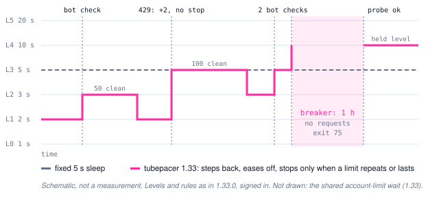
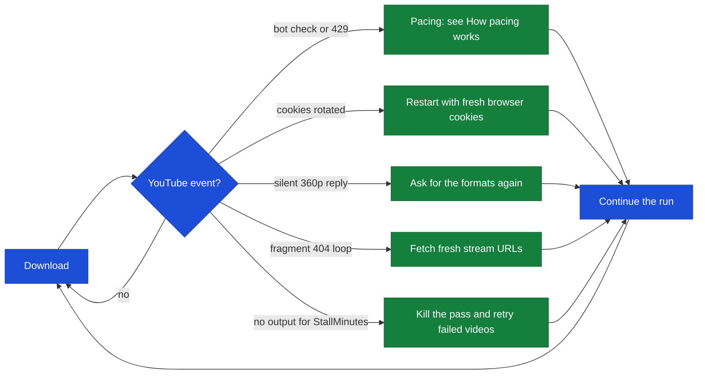
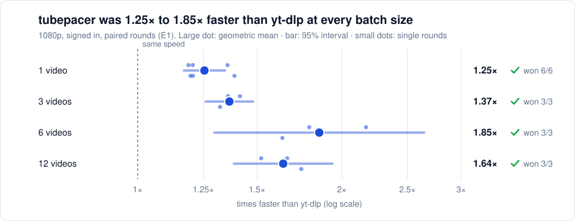
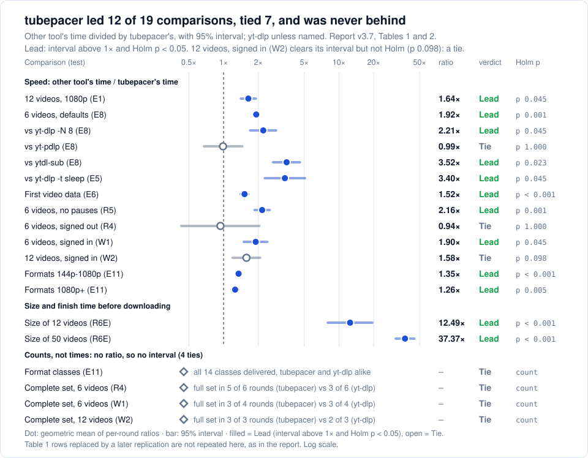
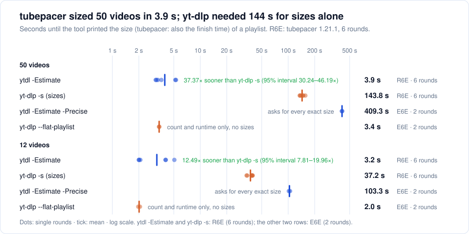

<div align="center">

<a href="#readme">
  <picture>
    <source media="(prefers-color-scheme: dark)" srcset=".github/banner-dark.svg">
    
  </picture>
</a>


tubepacer downloads YouTube videos, playlists and channels on Windows. It runs downloads in parallel, tells you how long a job will take before it starts, and backs off when YouTube pushes back. Built on [yt-dlp](https://github.com/yt-dlp/yt-dlp).

[](https://github.com/billyreagan/tubepacer/releases/latest "Release")
[](#get-started "Platform")
[](LICENSE "License")

[Get started](#get-started) · [Doctor](#the-doctor) · [Why tubepacer](#why-tubepacer) · [Recipes](#recipes) · [Pacing](#how-pacing-works) · [Recovery](#recovery) · [Options](#options) · [Files](#files-and-folders) · [Troubleshooting](#troubleshooting) · [Benchmarks](#benchmarks)

</div>

> [!NOTE]
> The program is **tubepacer**; the command, data folder and older docs say **`ytdl`**.

## Get started

**Scoop** (also installs yt-dlp, ffmpeg and deno):

```powershell
scoop bucket add tubepacer https://github.com/billyreagan/scoop-tubepacer
scoop install tubepacer
```

**Or by hand:**

1. `winget install yt-dlp.yt-dlp Gyan.FFmpeg DenoLand.Deno`
2. Extract [`tubepacer.zip`](https://github.com/billyreagan/tubepacer/releases/latest/download/tubepacer.zip) ([checksums](https://github.com/billyreagan/tubepacer/releases/latest/download/checksums.txt)) to a folder on `PATH`, e.g. `%USERPROFILE%\.local\bin`.
3. `Get-ChildItem "$env:USERPROFILE\.local\bin\ytdl*" | Unblock-File`

**Then:**

```powershell
ytdl -Doctor                                                     # check the setup
ytdl "https://www.youtube.com/watch?v=VIDEO_ID" -Browser firefox
```

Windows 10/11, PowerShell 5.1 or 7.

<details>
<summary><b>What it needs, and updating</b></summary>

* [**yt-dlp**](https://github.com/yt-dlp/yt-dlp) downloads; [**ffmpeg/ffprobe**](https://www.ffmpeg.org) merge and convert; [**deno**](https://deno.com) solves YouTube's JavaScript challenges (without it many formats are missing).
* Optional: **PowerShell 7** starts faster; `ytdl.cmd` prefers it.
* Optional: **a signed-in browser**. `-Browser` borrows its YouTube session: far fewer bot checks, plus members-only and age-restricted videos.

To update, extract a new release over the old one; your data in `%LOCALAPPDATA%\ytdl` is kept. `-AutoUpdate` updates yt-dlp once it's 7+ days old. `-Doctor` shows the right command for your install.

</details>

## The Doctor

```powershell
ytdl -Doctor                             # check everything (~3 s)
ytdl -Doctor "https://youtu.be/VIDEO_ID" # why won't this video download?
ytdl -Doctor -Fix                        # fix what it can, asking first
ytdl -Report                             # save the check for a bug report
```

| Area | Catches |
|---|---|
| Tools | Missing or old yt-dlp, ffmpeg, deno or tubepacer; **two copies on PATH** |
| Sign-in | Failing cookies; Chromium cookie lock; Chrome 127+ app-bound encryption; a `-Cookies` file that's empty, expired or 15+ days old |
| Folder and drive | No write access (incl. Controlled folder access); network drives, **OneDrive**, FAT32; long paths; free space; 1 GB+ of unfinished files |
| Network | YouTube unreachable; **clock 2+ min off**; VPN or proxy; IPv6 after bot checks |
| Pacing | Breaker, this hour's budget, the folder's saved level |
| Last run and schedule | How the last run and sync ended; a scheduled task that skips runs or points at another copy |

* **`-Doctor <link>`** spends one request (none while the breaker is open) to say whether a video can be downloaded, and if not, why (private, members-only, age-restricted, region-blocked, removed, bot check…) and the fix.
* **`-Fix`** asks before each command (default no): install or update tools, remove an extra copy, delete leftover locks or unfinished files, repair the scheduled sync. No admin; deletes only in the download and state folders. `-Yes` runs only the safe fixes, unasked.
* **`-Report`** saves the check to `Desktop\ytdl-doctor-<time>.txt`, copies it and prints the new-issue link. Links, titles, account options and user/PC names are hidden.

## Why tubepacer

Most downloaders avoid YouTube's limits with a fixed sleep on every video, needed or not. Signed in, tubepacer starts with no pause and slows down only when YouTube pushes back. All runs on the PC share one budget: a bot check slows them all, and a breaker stops them all so a short block isn't extended. It also recovers from what ends long runs: rotated cookies, silent 360p replies, expired stream URLs and hangs.

Measured on one PC and home connection ([full report](https://claude.ai/artifact/RLR1bpGc2kVgoo3Ca6LgTM)). "Not documented": not in the docs of any of 78 downloaders surveyed.

| | tubepacer | Others |
|---|---|---|
| **Adapts to limits** ([how](#how-pacing-works)) | 3.4× faster than yt-dlp with fixed sleeps, ~1.6× than yt-dlp with none (1.24, E5); 1.33.1 tied 1.24.2 (suite 17). 0 bot checks in 208 signed-in videos (E5–E6; yt-dlp also 0) | Fixed or random sleeps (yt-dlp, ytdl-sub); adaptive not documented |
| **Size and ETA up front** | 50 videos in 3.9 s (R6E, replicating E6E) | yt-dlp: 144 s, sizes only |
| **Survives cookie rotation** | Reloads in a median 1.6 s (3 rotations, one run, E10) | yt-dlp reads them once (kept going in E10, with warnings) |
| **Catches silent 360p** | Re-asks; 3 of 3 in a release test | yt-dlp saves it; ytdl-sub stops |
| **Pause in place** | `P` or `-Pause` | Stop and restart |
| **One run-wide speed cap** | `-LimitRate 5M` across workers | Per-stream caps |
| **Self-diagnosis** ([how](#the-doctor)) | `-Doctor`, `-Fix`, `-Report` | yt-dlp `-v`: a debug log |
| **Native Windows** | One zip or Scoop | Pinchflat, TubeArchivist, MeTube, Youtarr need Docker |

Also (E11): 1.26× vs yt-dlp over 1080p and up (planned) and 1.35× over 144p–1080p (chosen after the runs), all 14 format classes up to 8K HDR. Archive: 1,026 videos, 0 failed, 0 bot checks.

> [!NOTE]
> **Where others keep up:** yt-pdlp tied on 6 videos (0.99×, E8); signed out, tubepacer tied yt-dlp (0.94×, R4). The signed-out bot-check rerun was itself bot-blocked, so no claim either way.

## Recipes

```powershell
# Archive a channel overnight: estimate, then three workers
ytdl "https://www.youtube.com/@SomeChannel" -Browser firefox -Estimate
ytdl "https://www.youtube.com/@SomeChannel" -Browser firefox -Parallel 3 -Quality 1080

# Keep Plex/Jellyfin in sync, newest 20 (Jellyfin also gets .nfo files)
ytdl "https://www.youtube.com/@SomeChannel" -Subscribe -Browser firefox -Library jellyfin -Keep 20
ytdl -Schedule daily -At 03:00

# Playlist as audio, no re-encode
ytdl "https://www.youtube.com/playlist?list=PLAYLIST_ID" -AudioFormat m4a

# What's new on my subscriptions, and how long will it take?
ytdl -Sync -Estimate

# Queue a link for after the current run (-BrowserButton on: bookmark buttons for this)
ytdl "https://www.youtube.com/watch?v=VIDEO_ID" -Add
```
## How pacing works

Pacing asks YouTube less often; it never hides (no rotating proxies, fake fingerprints or account cycling). All runs on the PC share one state file, since YouTube limits the IP and account, not the folder.

**Budget.** 700 requests an hour signed out and 4,700 signed in (about 150 and 1,000 videos), roughly half of yt-dlp's wiki figures. At 80% the run slows a level; at 100% it waits for old requests to age out.

**Levels.**

| Level | L0 | L1 | L2 | L3 | L4 | L5 |
|---|---|---|---|---|---|---|
| Between videos | — | — | 3–6 s | 5–10 s | 10–20 s | 20–40 s |
| Before each request | — | 0.5 s | 1 s | 1 s | 2 s | 3 s |

* Starts at L1 signed in (L0 for ≤20 videos) or L3 signed out, and never goes below that.
* Bot check: up one level; 429: up two. Workers follow the slowest.
* Down one level after a clean streak (50 videos, then 100, then 200) with no limit hit on the PC for 30 min.
* The folder remembers its level, dropping one per two clean hours.

**Breaker.** A bot check at L5, or two within 10 minutes, stops every run on the PC for an hour (a 429 never does). New runs exit with code 75 without contacting YouTube. The first run afterwards tests one video, then resumes at the held level.

<picture>
  <source media="(prefers-color-scheme: dark)" srcset=".github/pacing-dark.svg">
  
</picture>

*Schematic, not a measurement.*

`-Sleep N` replaces pacing with a fixed pause; `-IgnoreCooldown` ignores the breaker. Details: [docs/pacing.md](docs/pacing.md). Share bot checks or big clean runs in [Pacing reports](https://github.com/billyreagan/tubepacer/discussions/categories/pacing-reports).

## Recovery



Each recovery is capped (see [Recovery options](#options)), so a failing run stops instead of looping.

## Options

`ytdl [URL] [OPTIONS]` · `ytdl -?` for help, `Get-Help ytdl -Full` for everything · names are case-insensitive and can be shortened (`-Par 3`).

<details>
<summary><b>General</b></summary>

Option | Does | Default
:---|:---|:---
`-Url URL` | Video, playlist or channel; the name is optional |
`-Version` | Print the version |
`-Doctor [URL]` / `-Fix` / `-Yes` / `-Report` | See [the doctor](#the-doctor) |
`-AutoUpdate` | Update yt-dlp first if 7+ days old |
`-Estimate` | Count, runtime and ETA, no download (with `-Sync`: what's new) |
`-YtdlpArgs 'OPTS'` | Extra yt-dlp options, e.g. `'--proxy socks5://127.0.0.1:9050'`. Connection options reach every call, others only the download; options tubepacer manages are refused |

</details>

<details>
<summary><b>Quality and format</b></summary>

Option | Does | Default
:---|:---|:---
`-Quality HEIGHT` | Max height: best, 4320, 2160, 1440, 1080, 720, 480, 360, 240, 144 | best
`-AudioOnly` / `-AudioFormat F` | Audio only: mp3 (re-encoded), m4a or opus (not re-encoded), or best. `-AudioFormat` implies `-AudioOnly` | mp3
`-Fast360` | With `-Quality 360`: combined H.264/AAC, for players without AV1 |
`-Subs` / `-SubLangs L` | Embed English + auto subtitles / these languages (comma-separated, or `all`) |
`-SponsorBlock MODE` | `mark` sponsor segments as chapters, or `remove` them |
`-LiveChat` | Save the live-chat replay as .json |
`-Container mp4\|mkv\|webm` | Output container (webm falls back to mkv) | mp4
`-Codec auto\|h264\|vp9\|av1` | Preferred codec | auto
`-Section "1:00-2:30"` | Only that part of one video, cut exactly (comma-separate several) |
`-SplitChapters` | Also one file per chapter |
`-Live` | Record a stream from its start, or wait for a scheduled one |

</details>

<details>
<summary><b>Sign-in and pacing</b></summary>

Option | Does | Default
:---|:---|:---
`-Browser NAME` | Use that browser's YouTube session (firefox, chrome, edge, brave, opera, vivaldi, chromium) |
`-Cookies FILE` | Or a Netscape cookies.txt |
`-SignInOnBlock NAME` | Start signed out; sign in with that browser after a bot check (use a spare account) | off
`-Sleep SECONDS` | Fixed pause between videos, randomized up to 2×. -1 = adaptive, 0 = none | -1
`-IgnoreCooldown` | Run while the breaker is open (may extend a block) | off
`-NoFastClient` | yt-dlp's default clients, not tubepacer's faster one |
`-PoToken` | PO tokens via bgutil (installed on first use; needs deno), mainly signed out |

</details>

<details>
<summary><b>Speed</b></summary>

Option | Does | Default
:---|:---|:---
`-Parallel N` | N videos at once (1–8) | 1
`-Fragments N` | Fetch 10 MiB pieces, N at once (0/1 = off) | 3 for 1–2 workers, else off
`-Dynamic` / `-Chunk N` | Workers pull N videos at a time from a shared queue (experimental) | 3
`-LimitRate RATE` | Run-wide cap, e.g. 5M or 800K/s |
`-Precise` | Exact size per video first (~8 s each), for mixed-resolution ETAs |
`-NoProbe` | Skip the background size lookup above 480p |

</details>

<details>
<summary><b>Filters</b></summary>

Option | Does
:---|:---
`-Items RANGE` | Playlist items, e.g. 1-10 or 3,5,7
`-MinMinutes` / `-MaxMinutes N` | Skip shorter / longer videos
`-Match` / `-Exclude REGEX` | Keep / skip matching titles
`-After DATE` | Uploaded on or after 2026-10-01, "30 days", "2 weeks"…

</details>

<details>
<summary><b>Subscriptions</b></summary>

A subscription saves a channel or playlist with its options; `-Sync` fetches only what's new for each.

Option | Does | Default
:---|:---|:---
`-Subscribe` / `-Unsubscribe` | Save / remove (by URL or list number; files kept) |
`-Subscriptions` | List them, last syncs and schedule |
`-Sync` | Download what's new |
`-Schedule daily\|hourly\|off` / `-At HH:MM` | Sync as a scheduled task | 03:00
`-Keep N` / `-KeepDays N` | After sync, delete all but the newest N / those older than N days |
`-Feed` / `-FeedBase URL` | After sync, write a podcast `feed.xml`; links use `-FeedBase` or `file:///` |

> [!WARNING]
> `-Keep` and `-KeepDays` delete files, but only ones tubepacer fetched for that subscription; the archive keeps them from returning.

</details>

<details>
<summary><b>Recovery</b></summary>

Option | Does | Default
:---|:---|:---
`-Retries N` | Extra passes over failed videos | 3
`-RetryDelay S` | Wait before each pass (first: 15 unless set) | 60
`-StallMinutes N` | Kill a silent pass (0 = off) | 10
`-MaxErrors N` | Abort after N errors in a row | 10
`-CookieRestarts N` | Restart on invalidated `-Browser` cookies | 10
`-FragmentRestarts N` | Restart on a fragment 404 loop | 5
`-MinFreeGB N` | Stop cleanly below N GB free | 2
`-NoSpaceCheck` | Skip the up-front space check |

</details>

<details>
<summary><b>Run control</b></summary>

Option | Does | Default
:---|:---|:---
`-Stop` / `-Pause` / `-Resume` | All runs (with `-Out DIR`, only those). In the window: P pauses, P or R resumes |
`-Add` | Queue this link if a run is busy, else download now |
`-Queue` / `-ClearQueue` | List / empty the queue |
`-BrowserButton on\|off` | `ytdl://` links and bookmark buttons for the open page |
`-Notify WHEN` | auto (long runs, failures, syncs with videos), on, off | auto
`-NoProgressBar` | Hide the progress bar |

</details>

<details>
<summary><b>Output</b></summary>

Option | Does | Default
:---|:---|:---
`-Out DIR` | Base folder | Videos
`-Folder NAME` | Folder | playlist/channel title, or "YouTube"
`-Library jellyfin\|plex` | Season/episode layout with posters (+ `.nfo` for jellyfin) |
`-NoMetadata` / `-NoThumbnail` | Skip embedded tags (~1 s a video) / cover art |
`-Template "%(id)s - %(title)s"` | yt-dlp file-name template (yt-dlp's `-o` is refused) | tubepacer's
`-History [N]` | Last N downloads; `-Match` filters | 20

</details>

## Files and folders

Path | Holds
:---|:---
`<Out>\<Folder>\.ytdl-archive.txt` | IDs already downloaded here
`<Out>\<Folder>\.ytdl-pace.json` | The folder's saved pacing level
`%LOCALAPPDATA%\ytdl\` `subscriptions.json`, `queue.json`, `tools.json` | Subscriptions, queued links, tool paths
`%LOCALAPPDATA%\ytdl\history.tsv` | Finished downloads
`%LOCALAPPDATA%\ytdl\pace-<network>.json` | Shared breaker, budget and bot checks

`-Library` makes each channel a show and each upload year a season; the episode is the upload month, day and hour (here 14 Nov, 03:00):

```
<Out>\<Channel>\Season 2026\<Channel> - s2026e111403 - <Title> [<id>].mp4
```

## Troubleshooting

Start with `ytdl -Doctor -Browser firefox`.

Problem | Fix
:---|:---
"Confirm you're not a bot" | Add `-Browser <name>`; pacing slows itself
Formats missing, or only 360p | Install deno, update yt-dlp
"Running scripts is disabled" | Use `ytdl.cmd`, or `Set-ExecutionPolicy -Scope CurrentUser RemoteSigned` and `Unblock-File`
Run seems stuck | It restarts after `-StallMinutes` of silence; P pauses, Ctrl+C stops

## Benchmarks

Tools run in paired rounds on the same videos. A lead counts only if its 95% interval stays above 1 after Holm correction for 19 comparisons: tubepacer leads 12, ties 7, trails none. One pool (E11, 144p–1080p) was chosen after the runs. All on one PC and connection; most runs signed in.

<picture>
  <source media="(prefers-color-scheme: dark)" srcset=".github/speedup-dark.svg">
  
</picture>

<picture>
  <source media="(prefers-color-scheme: dark)" srcset=".github/compare-dark.svg">
  
</picture>

<picture>
  <source media="(prefers-color-scheme: dark)" srcset=".github/firstanswer-dark.svg">
  
</picture>

Charts, scripts and raw data for every run: the [benchmark report](https://claude.ai/artifact/RLR1bpGc2kVgoo3Ca6LgTM) (v4.0, 20 Nov 2026; it predates the name).

## Built on yt-dlp

tubepacer runs yt-dlp unchanged, reads its output and restarts it on known failures; it isn't affiliated with yt-dlp. Extraction and site bugs go to [yt-dlp](https://github.com/yt-dlp/yt-dlp/issues); pacing, estimate, parallel, subscription and recovery bugs go [here](https://github.com/billyreagan/tubepacer/issues).

Download only what you have the right to keep, and follow YouTube's terms of service.

The mark is Pulse: a steady line, a dip at a bot check, the recovery, then play.

### Contributing

[ytdl-NOTES.md](ytdl-NOTES.md) records each release's changes and checks; timing changes need a benchmark run.

* **Bug reports**: include `ytdl -Version`, the full command, and the log path printed at the end of the run
* **Versioning**: minor (1.**21**.0) adds options or changes behaviour; patch (1.21.**1**) fixes and tunes

### License

<p align="center"><a href="#readme"><picture><source media="(prefers-color-scheme: dark)" srcset=".github/brand/pulse-dark.svg"></picture></a></p>

[MIT](LICENSE).
