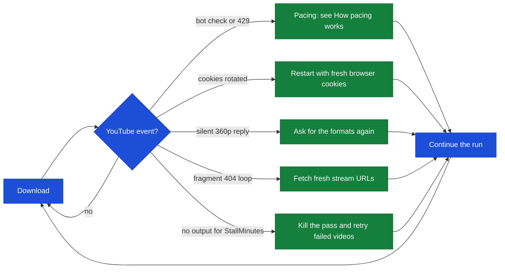

<div align="center">

<a href="#readme">
  <picture>
    <source media="(prefers-color-scheme: dark)" srcset=".github/banner-dark.svg">
    
  </picture>
</a>

<!-- TODO (E3): add a short recording of a real run here (for example .github/run.gif from an actual 12-video job). Use a real capture only, never a staged one. -->

tubepacer downloads YouTube videos, playlists and channels on Windows. It keeps itself under YouTube's limits: full speed when it can, a measured step back when YouTube pushes back, and a full stop before a slowdown turns into a ban. It runs downloads in parallel and tells you how long a job will take before it starts. Built on [yt-dlp](https://github.com/yt-dlp/yt-dlp).

[](https://github.com/billyreagan/tubepacer/releases/latest "Release")
[](#get-started-in-a-minute "Platform")
[](LICENSE "License")

</div>

> [!NOTE]
> **tubepacer** is the program's name. **`ytdl`** is the command you type, and the script files are `ytdl.ps1` and `ytdl.cmd`. Every example below starts with `ytdl`.

* [Why tubepacer](#why-tubepacer)
* [Get started in a minute](#get-started-in-a-minute)
* [What tubepacer does that others don't](#what-tubepacer-does-that-others-dont)
* [Recipes](#recipes)
* [How pacing works](#how-pacing-works)
* [How recovery works](#how-recovery-works)
* [Options](#options)
* [Files and folders](#files-and-folders)
* [Troubleshooting](#troubleshooting)
* [Benchmarks](#benchmarks)
* [Built on yt-dlp](#built-on-yt-dlp)

## Why tubepacer

YouTube slows down and bot-checks anyone who downloads a lot at once. The usual answer is a fixed sleep between videos, which wastes time on every video, whether YouTube was pushing back or not.

tubepacer runs at full speed while you are signed in, steps back only when YouTube pushes back, and eases back to speed once it stops. All runs and parallel workers on the PC share one hourly budget and one pace, so one bot check slows everything instead of each worker learning it separately. If YouTube keeps pushing, a circuit breaker stops all downloads for an hour instead of digging the hole deeper.

Pacing works by asking YouTube less often, not by hiding. tubepacer doesn't rotate proxies or IP addresses, fake browser fingerprints, or cycle cookies across accounts.

It also handles what usually ends a long run: rotated sign-in cookies, silent 360p replies, expired stream URLs and hung downloads. It recovers and carries on. `ytdl -Doctor` checks the setup and says how to fix what's wrong, and `-AutoUpdate` keeps yt-dlp current.

## Get started in a minute

With [Scoop](https://scoop.sh), one step installs tubepacer, yt-dlp, ffmpeg and deno; then skip to step 5:

```powershell
scoop bucket add tubepacer https://github.com/billyreagan/scoop-tubepacer
scoop install tubepacer
```

Or by hand:

1. Install yt-dlp, ffmpeg and deno:

    ```powershell
    winget install yt-dlp.yt-dlp Gyan.FFmpeg DenoLand.Deno
    ```

2. Download [`tubepacer.zip`](https://github.com/billyreagan/tubepacer/releases/latest/download/tubepacer.zip) (and [`checksums.txt`](https://github.com/billyreagan/tubepacer/releases/latest/download/checksums.txt) to verify it). The zip holds `ytdl.ps1`, its Command Prompt launcher `ytdl.cmd` (with its helper `ytdl-cmd.ps1`), and the changelog `ytdl-NOTES.md`.

3. Extract it to a folder on your `PATH`, for example `%USERPROFILE%\.local\bin`.

4. Unblock the scripts once, since Windows marks downloaded files:

    ```powershell
    Get-ChildItem "$env:USERPROFILE\.local\bin\ytdl*" | Unblock-File
    ```

5. Check that everything is found:

    ```powershell
    ytdl -Doctor
    ```

6. Download something:

    ```powershell
    ytdl "https://www.youtube.com/watch?v=VIDEO_ID" -Browser firefox
    ```

Requirements: Windows 10/11, PowerShell 5.1 or 7.

<details>
<summary><b>What it needs, and updating</b></summary>

* [**yt-dlp**](https://github.com/yt-dlp/yt-dlp): the download engine. Every video tubepacer fetches goes through it
* [**ffmpeg** and **ffprobe**](https://www.ffmpeg.org): merge separate video and audio streams, embed metadata, thumbnails and subtitles, and convert audio
* [**deno**](https://deno.com): runs YouTube's JavaScript challenges for yt-dlp. Without it many formats are missing
* Optional: **PowerShell 7** ([`winget install Microsoft.PowerShell`](https://github.com/PowerShell/PowerShell)) starts faster than Windows PowerShell 5.1, and `ytdl.cmd` prefers it when installed
* Optional: **a signed-in browser** (Firefox, Chrome, Edge, Brave, Opera, Vivaldi or Chromium). `-Browser` uses its YouTube session, which avoids most bot checks and unlocks members-only and age-restricted videos

tubepacer finds these tools on `PATH` or in winget's install folders and caches their locations in `%LOCALAPPDATA%\ytdl\tools.json`.

`ytdl -Version` prints the installed version. To update tubepacer, extract the latest release over the old files; subscriptions, the queue and learned estimates live in `%LOCALAPPDATA%\ytdl` and are kept. yt-dlp changes often to keep up with YouTube: `-AutoUpdate` updates it before a run when it is 7 or more days old (checked at most once a day), with the manager it came from: Scoop, winget, pip or pipx. For a Chocolatey install it prints the admin command instead. `ytdl -Doctor` shows the update command for your install.

</details>

> [!TIP]
> Run `ytdl -Doctor` whenever something looks wrong. It checks yt-dlp, ffmpeg, deno, sign-in, free space, pacing and the schedule, flags duplicate copies on PATH, leftover unfinished files and an outdated ytdl, says how the last run ended, catches a folder that can't be written to or sits on a network drive, in OneDrive or on FAT32, cookies a browser won't give up, a wrong clock, a VPN and a schedule that skips runs, and gives the fix for each problem in the way you installed it. To ask for help, `ytdl -Report` saves the same check (personal details hidden) and opens the way to a new issue.

## What tubepacer does that others don't

Measured on one Windows PC and home connection; every run, script and raw result is in the [benchmark report](https://claude.ai/artifact/HBzdTEVdfXRFG6b9RpPMiT) (which calls the program by its command, `ytdl`). "Not documented" means none of the 78 downloaders we surveyed lists it.

| | tubepacer | Others |
|---|---|---|
| **Stays under YouTube's limits.** Shared hourly budget; steps back on a bot check, eases back after clean videos; a circuit breaker stops before a block becomes a ban ([how](#how-pacing-works)). | 0 bot checks in 208 videos, signed in (E5–E6); 3.3× faster than yt-dlp's fixed sleeps on the same 6 videos (E5) | Fixed or random sleeps (yt-dlp `-t sleep`, ytdl-sub); adaptive pacing not documented |
| **Size and finish time before the first byte.** | 50 videos: count, size and ETA in 7.2 s (E6E, replicated in R6E) | yt-dlp needs 153 s for sizes alone; whole-run ETA not documented |
| **A finish time that stays honest.** | Median 20.5 s off across 167 printed estimates (E7) | Per-file ETA only |
| **Recovers when sign-in cookies rotate.** | Downloading again in a median 1.6 s; all 3 rotations recovered (E10) | Cookies read once at start |
| **Catches YouTube's silent 360p replies.** | Re-asks and continues; 3 of 3 caught (release test) | yt-dlp saves 360p silently; ytdl-sub detects and stops |
| **Pause and resume in place.** | `P` in the window or `-Pause` from any terminal | Stop and restart |
| **One speed cap for the whole run**, shared by parallel downloads. | `-LimitRate 5M` | Per-stream caps |
| **Native Windows.** No Docker, Python or server. | One zip + `winget` | Self-hosted archivers (Pinchflat, TubeArchivist, MeTube, Youtarr) need Docker |

Also measured: 1.64× faster than yt-dlp on a 12-video 1080p batch (E1); 1,026 archive videos in five runs, signed in, 0 failed; yt-dlp start-up 1.0 s → 0.33 s; 1,036 missed thumbnail lookups per season → 0.

> [!NOTE]
> **Where others lead.** Signed out, tubepacer drew 1.52× as many bot checks as yt-dlp (E9), though it delivered 44 of 80 videos to yt-dlp's 0. On the 6-video job, yt-pdlp tied it (0.99×, E8).

## Recipes

**Archive a whole channel overnight.** Check the size and time first, then run it with three workers:

```powershell
ytdl "https://www.youtube.com/@SomeChannel" -Browser firefox -Estimate
ytdl "https://www.youtube.com/@SomeChannel" -Browser firefox -Parallel 3 -Quality 1080
```

**Keep a Plex or Jellyfin library in sync.** Subscribe once with the layout and retention you want, then let a daily task fetch what's new. Jellyfin also gets an `.nfo` per episode:

```powershell
ytdl "https://www.youtube.com/@SomeChannel" -Subscribe -Browser firefox -Library jellyfin -Keep 20
ytdl -Schedule daily -At 03:00
```

**A playlist as audio.** m4a is YouTube's own stream, so nothing is re-encoded:

```powershell
ytdl "https://www.youtube.com/playlist?list=PLAYLIST_ID" -AudioFormat m4a
```

**How long will this take?** Count, size and ETA without downloading; with `-Sync`, what's new on your subscriptions:

```powershell
ytdl "https://www.youtube.com/@SomeChannel" -Estimate
ytdl -Sync -Estimate
```

<picture><source media="(prefers-color-scheme: dark)" srcset=".github/brand/pulse-paused-dark.svg"></picture> **Pause a big run and resume later.** Press `P` in the download window, or from any other terminal:

```powershell
ytdl -Pause
ytdl -Resume
```

**Queue a link while a run is busy.** It starts when the current run finishes. `-BrowserButton on` makes bookmark buttons that do the same from the open page:

```powershell
ytdl "https://www.youtube.com/watch?v=VIDEO_ID" -Add
ytdl -Queue
```

## How pacing works

Pacing asks YouTube less often. It doesn't hide.

> **What tubepacer will not do:** rotate proxies or IP addresses, fake browser fingerprints, or cycle cookies across accounts.

It has three parts, and all ytdl runs and workers on the PC share them through `%LOCALAPPDATA%\ytdl\pace.json`, because YouTube limits the IP address and the account, not the folder.

**Budget.** A shared one-hour log of videos started. The limit is about half of the figures in yt-dlp's wiki: 150 videos an hour signed out and 1,000 signed in. At 80% of the limit the run slows down one level. Over the limit, it waits until the oldest start drops out of the hour, then carries on.

**Steps.** There are six levels, from L0 (no pauses) to L5 (20–40 s between videos, 3 s before each request). A bot check moves the run up one level and a 429 moves it up two. All parallel workers follow the slowest. After 25 videos in a row without a bot check, the run comes down one level, but never below its starting level: L1 signed in (L0 for 20 videos or fewer) and L3 signed out. A step-back is saved and loses one level for every two hours without a bot check, so the next run starts where it should.

**Breaker.** A 429, a bot check at L5, or a second bot check within 10 minutes on this PC stops every run on the PC for one hour. Each repeat within 24 hours doubles the pause, up to 24 hours. While the breaker is open, new runs print the time it closes and exit (code 75) without asking YouTube anything, so closing the window is fine. The first run after it checks one video before starting the rest, at the level that was held.

<picture>
  <source media="(prefers-color-scheme: dark)" srcset=".github/pacing-dark.svg">
  
</picture>

*Schematic, not a measurement.*

It also tells YouTube's signals apart:

| Signal | What it usually means | What tubepacer does |
|---|---|---|
| HTTP 429, or "isn't available, try again later" | Over YouTube's limit | Up two levels and opens the breaker |
| "Confirm you're not a bot", signed out | The connection's reputation | Up one level, and suggests `-Browser` |
| "Video unavailable" three times, signed in | The account may be limited | Suggests trying without `-Browser`/`-Cookies` |
| 429 on captions only | Captions have a stricter limit | Captions wait 10 s each; videos are not slowed |

yt-dlp's own retries back off too (`--retry-sleep`: extractor 5–300 s, http 1–30 s, fragment 1–20 s, exponential) instead of firing back to back. `ytdl -Doctor` shows the breaker, this hour's budget and the folder's saved level. `-Sleep N` turns adaptive pacing off and uses a fixed pause, and `-IgnoreCooldown` starts while the breaker is open, which isn't advised. The full design, with sources, is in [docs/pacing.md](docs/pacing.md). Hit a bot check, or ran a big job without one? Share it in [Pacing reports](https://github.com/billyreagan/tubepacer/discussions/categories/pacing-reports): runs on other connections show where YouTube's limits really sit.

## How recovery works



Each recovery has a limit (`-CookieRestarts`, `-FragmentRestarts`, `-Retries`, `-MaxErrors`), so a run that keeps failing stops instead of looping.

## Options

```
ytdl [URL] [OPTIONS]
```

`ytdl -?` prints a short help and `Get-Help ytdl -Full` the full one. Options are PowerShell parameters: names are case-insensitive and can be shortened while they stay unique (`-Par 3`).

<details>
<summary><b>General</b></summary>

Option | What it does | Default
:---|:---|:---
`-Url URL` | Video, playlist or channel link. The first argument, so the name can be left out |
`-Version` | Print the version and exit |
`-Doctor` | Check yt-dlp, ffmpeg, deno, sign-in, free space, pacing and the schedule, plus duplicate copies on PATH, unfinished files (WARN at 1 GB), the ytdl version and how the last run ended, the drive and a write test, long paths, cookies, the clock, VPN/proxy, IPv6 and the schedule's result in words; print what is wrong and how to fix it (hints match how each tool was installed), then exit |
`-Report` | Run the doctor and save its lines plus Windows version, install method and console encoding to `Desktop\ytdl-doctor-<time>.txt` with links, account options and user/PC names hidden; copy it to the clipboard and print the new-issue link |
`-Estimate` | Scan the link and print the video count, total runtime and estimated download time; no download. With `-Sync`: show what is new |
`-YtdlpArgs 'OPTIONS'` | Any other yt-dlp options, as one quoted string, e.g. `'--proxy socks5://127.0.0.1:9050'`. Connection options reach every yt-dlp call, the rest only the download. Options tubepacer manages itself are refused, with the name of its own option to use instead |

</details>

<details>
<summary><b>Quality and format</b></summary>

Option | What it does | Default
:---|:---|:---
`-Quality HEIGHT` | Highest video height: best, 4320, 2160, 1440, 1080, 720, 480, 360, 240 or 144 | best
`-AudioOnly` | Extract audio only (mp3 unless `-AudioFormat` says otherwise) |
`-AudioFormat FORMAT` | mp3 (re-encoded, plays everywhere), m4a or opus (YouTube's own stream, no re-encode), or best. Implies `-AudioOnly` | mp3
`-Fast360` | With `-Quality 360`: YouTube's combined H.264/AAC stream, for players without AV1 |
`-Subs` | Download English and auto-generated subtitles and embed them |
`-SponsorBlock MODE` | `mark`: add chapters at sponsor, intro and self-promotion segments; `remove`: cut them |
`-SubLangs LANGS` | Subtitle languages to embed, comma-separated (`all` = every language). Implies `-Subs` |
`-LiveChat` | Save the live-chat replay as a .json next to the video |
`-Container mp4\|mkv\|webm` | Container of the merged file (webm falls back to mkv when the streams don't fit) | mp4
`-Codec auto\|h264\|vp9\|av1` | Preferred video codec at the chosen height | auto
`-Section "1:00-2:30"` | Download only that part of one video (comma-separated for several), cut exactly |
`-SplitChapters` | Also write one file per chapter, in a folder named after the video |
`-Live` | Record a live stream from its start, or wait for a scheduled one. One stream: a video link or a channel's `/live` link |

</details>

<details>
<summary><b>Sign-in and pacing</b></summary>

Option | What it does | Default
:---|:---|:---
`-Browser NAME` | Use your signed-in YouTube session from firefox, chrome, edge, brave, opera, vivaldi or chromium |
`-Cookies FILE` | Or: an exported cookies.txt (Netscape format) |
`-Sleep SECONDS` | Pause between videos, randomized up to 2x. -1 = adaptive pacing, 0 = none | -1
`-IgnoreCooldown` | Start even while the limit guard's breaker is open after a YouTube block. Not advised: requests during a block are thought to extend it | off
`-NoFastClient` | Use yt-dlp's default YouTube clients instead of tubepacer's faster single-client extraction |
`-PoToken` | Get YouTube PO tokens from the bgutil provider, installed on first use (needs deno). Mainly for signed-out runs |

</details>

<details>
<summary><b>Speed</b></summary>

Option | What it does | Default
:---|:---|:---
`-Parallel N` | Download N videos at once, 1-8, in separate worker processes | 1
`-Fragments N` | Fetch each file as 10 MiB pieces, N at once. 0 or 1 = off | 3 with 1 or 2 workers, off with 3+
`-Dynamic` | With `-Parallel`: hand out videos from a shared queue in batches of `-Chunk`, so a worker that finishes early takes more. Experimental | chunk 3
`-LimitRate RATE` | Cap the whole run's speed, e.g. 5M or 800K per second, split across running downloads |
`-Precise` | Look up each video's exact size first (about 9 s per video) for an accurate ETA when resolutions vary |
`-NoProbe` | Skip the background size lookup used for the ETA above 480p |

</details>

<details>
<summary><b>Filters</b></summary>

Option | What it does | Default
:---|:---|:---
`-Items RANGE` | Only these playlist items, e.g. 1-10 or 3,5,7 |
`-MinMinutes N` | Skip videos shorter than N minutes |
`-MaxMinutes N` | Skip videos longer than N minutes |
`-Match REGEX` | Keep only titles matching REGEX (case-insensitive) |
`-Exclude REGEX` | Skip titles matching REGEX |
`-After DATE` | Only videos uploaded on or after DATE: 2026-10-01, or relative: "30 days", "2 weeks" |

</details>

<details>
<summary><b>Subscriptions</b></summary>

A subscription is a channel or playlist link saved with the options you give alongside it. `-Sync` runs every subscription with its own options and downloads only what is new; the folder's archive skips the rest.

Option | What it does | Default
:---|:---|:---
`-Subscribe` | Save this channel or playlist, with the options given alongside it |
`-Unsubscribe` | Remove a subscription by URL or by its number in `-Subscriptions`. Files are kept |
`-Subscriptions` | List subscriptions, their last sync and the schedule |
`-Sync` | Download what is new on every subscription |
`-Schedule WHEN` | Run `-Sync` as a Windows scheduled task: daily, hourly, or off to remove it |
`-At HH:MM` | Time of day for `-Schedule` | 03:00
`-Keep N` | After each `-Sync`, delete this subscription's oldest videos beyond the newest N |
`-KeepDays N` | After each `-Sync`, delete this subscription's videos uploaded more than N days ago |
`-Feed` / `-FeedBase URL` | After each `-Sync`, write a podcast feed (`feed.xml`) of the files still in the folder. `-FeedBase` is the web address the folder is served at; without it the links are `file:///` |

> [!WARNING]
> `-Keep` and `-KeepDays` delete files. They only touch files tubepacer downloaded for that subscription, and the archive stops deleted videos from downloading again.

</details>

<details>
<summary><b>Recovery</b></summary>

Option | What it does | Default
:---|:---|:---
`-Retries N` | Extra passes over failed videos only. 0 = off | 3
`-RetryDelay SECONDS` | Wait before each retry pass (the first retry waits 15 unless given) | 60
`-StallMinutes N` | Kill a pass that prints nothing for N minutes. 0 = off | 10
`-MaxErrors N` | Abort after N errors in a row with no download between them | 10
`-CookieRestarts N` | With `-Browser`: restart with fresh cookies when YouTube invalidates them, up to N times | 10
`-FragmentRestarts N` | Restart with fresh stream URLs on a fragment 404 loop, up to N times | 5
`-MinFreeGB N` | Stop cleanly when free space drops below N GB | 2
`-NoSpaceCheck` | Skip the up-front check that the download fits on the drive |

</details>

<details>
<summary><b>Run control</b></summary>

Option | What it does | Default
:---|:---|:---
`-Stop` | Stop every running download, then exit |
`-Pause` | Pause every running download (with `-Out DIR`: only runs saving there). P in the window also pauses |
`-Resume` | Resume paused runs. P or R in the window too |
`-Add` | If a run is busy, queue this link for when it finishes; otherwise download it now |
`-Queue` | List queued links and running downloads |
`-ClearQueue` | Empty the queue |
`-BrowserButton on\|off` | Register the `ytdl://` link and make bookmark buttons that download or subscribe to the open page, with the options given alongside |
`-Notify WHEN` | Windows notification when a run ends: auto (runs over 2 minutes, failures, syncs that found videos), on, or off | auto
`-NoProgressBar` | Hide the progress bar at the bottom of the window |

</details>

<details>
<summary><b>Output</b></summary>

Option | What it does | Default
:---|:---|:---
`-Out DIR` | Base folder for downloads | your Videos folder
`-Folder NAME` | Folder name | the playlist or channel title, or "YouTube" for single videos
`-Library jellyfin\|plex` | Lay files out as seasons and episodes for a media server, with posters; jellyfin also gets an `.nfo` per episode |
`-NoMetadata` | Don't embed title, date and uploader tags (saves about 1 s per video) |
`-NoThumbnail` | Don't embed the thumbnail as cover art |
`-Template "%(id)s - %(title)s"` | yt-dlp output template for the file name only; the folder is still tubepacer's | tubepacer's name
`-History [N]` | List the last N downloads (date, height, size or "deleted", title, folder); `-Match` filters titles | 20

</details>

## Files and folders

Downloads go to `<Out>\<Folder>\`, where `<Folder>` is the playlist or channel title. tubepacer names the files itself, so yt-dlp's `-o` is refused; use `-Template` for the file name, `-Folder` or `-Library` for the folder. The data folder is named after the command, `ytdl`.

Path|Holds
:---|:---
`<Out>\<Folder>\.ytdl-archive.txt`|IDs of the videos already downloaded into this folder
`%LOCALAPPDATA%\ytdl\subscriptions.json`|Subscriptions and their saved options
`%LOCALAPPDATA%\ytdl\queue.json`|Links waiting for the running download
`%LOCALAPPDATA%\ytdl\tools.json`|Where yt-dlp, ffmpeg and deno were found
`%LOCALAPPDATA%\ytdl\history.tsv`|Every finished download, for `-History` (from 1.23.0 on)
`%LOCALAPPDATA%\ytdl\pace.json`|The limit guard, shared by every run on the PC: breaker, hourly budget, recent bot checks (from 1.25.0 on)
`<Out>\<Folder>\.ytdl-pace.json`|This folder's saved pacing level after a bot check

With `-Library`, files follow the media-server convention, one show per channel and one season per upload year:

```
<Out>\<Channel>\Season 2026\<Channel> - s2026e111403 - <Title> [<id>].mp4
```

`s2026e111403` reads as season 2026 (the upload year), episode `111403` (upload month, day and hour: 14 November, 03:00), so episodes sort by date and two uploads on one day stay separate. A video without an upload date goes to `Season 0000`; one without an upload time gets hour `00`.

## Troubleshooting

Start with:

```powershell
ytdl -Doctor -Browser firefox
```

Problem|Fix
:---|:---
"Sign in to confirm you're not a bot"|Add `-Browser <name>` with a browser signed in to YouTube. Adaptive pacing slows down by itself after a bot check
Formats missing or only 360p|Install deno (`winget install DenoLand.Deno`) and update yt-dlp
"Running scripts is disabled on this system"|Run `Unblock-File` on the scripts, or use `ytdl.cmd`
A run seems stuck|tubepacer kills a pass after `-StallMinutes` of silence and retries; press P to pause, Ctrl+C to stop

## Benchmarks

Every run uses the same PC and connection, and compared tools run in paired rounds on the same videos. The verdict rule was fixed before the later suites ran, and a tie is reported as a tie and a loss as a loss. Of 13 comparisons, tubepacer leads 9, ties 3 and is behind in 1 (signed out, E9).

<picture>
  <source media="(prefers-color-scheme: dark)" srcset=".github/speedup-dark.svg">
  
</picture>

The [benchmark report](https://claude.ai/artifact/HBzdTEVdfXRFG6b9RpPMiT) has the charts, the scripts and the raw results, so every run can be repeated. It predates the name tubepacer and calls the program `ytdl`.

## Built on yt-dlp

tubepacer is a wrapper and is not affiliated with the yt-dlp project. It does not change yt-dlp: it chooses yt-dlp's options, runs it, reads its output, and restarts it when a known failure appears. Bugs in extraction or site support belong to [yt-dlp's issue tracker](https://github.com/yt-dlp/yt-dlp/issues); bugs in pacing, estimates, parallel runs, subscriptions or recovery belong [here](https://github.com/billyreagan/tubepacer/issues).

Download only videos you have the right to keep, and follow YouTube's terms of service.

The mark is Pulse: a steady line, a dip at a bot check, the recovery, then play.

### Contributing

Each release records what changed and how it was verified in [ytdl-NOTES.md](ytdl-NOTES.md). Changes to timing behaviour need a benchmark run; see the report for the method.

* **Bug reports**: include `ytdl -Version`, the full command, and the log path tubepacer prints at the end of a run
* **Versioning**: minor versions (1.**21**.0) add options or change behaviour; patch versions (1.21.**1**) fix and tune

### License

<p align="center"><a href="#readme"><picture><source media="(prefers-color-scheme: dark)" srcset=".github/brand/pulse-dark.svg"></picture></a></p>

[MIT](LICENSE).
